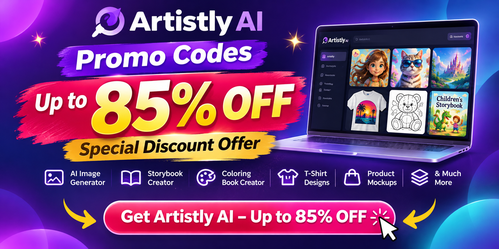

# 🎨 Artistly AI Promo Codes – Up to 85% OFF Discount (2026)

  

  <strong>Looking for an Artistly AI promo code or discount code?</strong> 
  Discover the latest promotional offer and explore AI-powered creative tools.

  <a href="https://deal.ink/Artistly"><strong>🔥 CLAIM YOUR ARTISTLY AI DISCOUNT – UP TO 85% OFF</strong></a>

---

## 📑 Table of Contents

- [Artistly AI Promo Code – 85% OFF](#-artistly-ai-promo-code--85-off)
- [What Is Artistly AI?](#-what-is-artistly-ai)
- [Artistly AI Review – Is It Worth It?](#-artistly-ai-review--is-it-worth-it)
- [Artistly AI Features](#-artistly-ai-features)
- [Pros and Cons](#-pros-and-cons)
- [How to Make Money Using Artistly AI](#-how-to-make-money-using-artistly-ai)
- [Artistly AI Pricing and Discounts](#-artistly-ai-pricing-and-discounts)
- [How to Get the Artistly AI Discount](#-how-to-get-the-artistly-ai-discount)
- [Who Should Use Artistly AI?](#-who-should-use-artistly-ai)
- [Frequently Asked Questions](#-frequently-asked-questions)
- [Final Verdict](#-final-verdict)
- [Affiliate Disclosure](#-affiliate-disclosure)

---

## 🎁 Artistly AI Promo Code – 85% OFF

Searching for an active **Artistly AI promo code, Artistly discount code, or Artistly coupon code?**

You're in the right place!

Check the special promotional offer to discover potential savings of up to 85% OFF on Artistly AI.

👉 [**CLICK HERE TO CLAIM YOUR ARTISTLY AI DISCOUNT**](https://deal.ink/Artistly)

Why pay full price when you can check the latest available promotional offer?

- Special promotional pricing
- Potential savings of up to 85%
- AI-powered creative tools
- Options for digital product creators and online businesses

*Discount availability, eligibility, and final pricing are subject to the current offer and checkout terms.*

---

## 🎨 What Is Artistly AI?

Artistly AI is an AI-powered creative platform designed to help users generate artwork, illustrations, digital designs, and other visual content.

Instead of spending hours creating designs manually or paying for expensive design services, you can use AI-powered tools to turn your creative ideas into visual assets.

Artistly AI is particularly interesting for Etsy sellers, digital entrepreneurs, graphic designers, content creators, and online marketers who regularly need original visual content.

Whether you want to create digital clipart, children's book illustrations, coloring pages, product mockups, or marketing graphics, Artistly AI provides a range of creative tools to explore.

---

## ⭐ Artistly AI Review – Is It Worth It?

If you're considering purchasing Artistly AI, you probably want to know whether it's actually useful for your creative projects.

Here's an overview of what makes this platform worth considering.

### 1. Creative Possibilities

One of the interesting aspects of Artistly AI is its range of creative applications.

Rather than focusing exclusively on generating AI images, it offers different tools for editing, illustrating, designing, and developing visual content.

This can be useful if you regularly work on multiple creative projects.

### 2. Useful for Digital Product Businesses

For Etsy sellers and digital entrepreneurs, producing new designs consistently can be challenging.

Artistly AI can help with developing:

- Digital clipart bundles
- Printable wall art
- Coloring book illustrations
- Digital stickers
- Children's storybook artwork
- T-shirt designs
- Product mockups

This makes it particularly interesting for people building digital product businesses.

### 3. AI-Powered Creative Workflow

AI image generation can reduce the time spent creating initial design concepts.

You can experiment with different prompts, styles, and creative directions without starting every design from scratch.

However, AI-generated content still requires human review, editing, and quality control.

### 4. Potential Value for Money

The value of Artistly AI depends on how frequently you use its tools and which features are included in your selected plan.

If you regularly create artwork, digital products, or marketing graphics, having multiple creative tools available in one platform may be useful.

### My Review Summary

Artistly AI is worth exploring if your work involves regularly creating visual content.

Its strongest potential appeal is the combination of AI image generation, editing, and creative applications for digital product businesses.

However, before purchasing, review the available features, usage limits, payment terms, and commercial licensing conditions.

---

## 🚀 Artistly AI Features

Artistly AI offers a variety of AI-powered creative tools.

Some of the key capabilities include:

| Feature                | What It Can Help You Create       |
| ---------------------- | --------------------------------- |
| AI Image Generator     | Original AI-generated artwork     |
| AI Image Editor        | Edit and refine images            |
| Background Remover     | Remove image backgrounds          |
| AI Image Upscaler      | Improve image resolution          |
| Style Replicator       | Experiment with artistic styles   |
| Character Generator    | Create consistent characters      |
| Storybook Creator      | Develop illustrated stories       |
| Coloring Book Creator  | Generate coloring pages           |
| Clipart Designer       | Create themed clipart collections |
| T-Shirt Designer       | Develop apparel graphics          |
| Product Mockup Creator | Present designs on products       |
| Logo Maker             | Explore logo concepts             |
| Product Photographer   | Create product visuals            |
| Book Cover Creator     | Develop book cover concepts       |
| Fashion Designer       | Experiment with fashion designs   |

*Feature availability may depend on the selected plan.*

---

## ⚖️ Pros and Cons

Every AI platform has advantages and limitations. Here's what to consider before purchasing Artistly AI.

### ✅ Pros

- Multiple creative tools in one platform.
- AI-assisted artwork generation.
- Useful for digital product development.
- Can help speed up creative workflows.
- Suitable for experimenting with different visual styles.
- Potential applications for Etsy and print-on-demand businesses.
- Useful for content creators and online marketers.

### ❌ Cons

- AI-generated images may require additional editing.
- Results depend heavily on prompt quality.
- Complex designs may need several attempts.
- Commercial licensing conditions need to be reviewed.
- The value depends on your actual usage.
- Features and usage limits may vary between plans.

---

## 💰 How to Make Money Using Artistly AI

One interesting use of AI image generation tools is creating digital products that can potentially be sold online.

If you're running an Etsy shop, Payhip store, or another digital product business, Artistly AI can help with the creative production process.

Here are some ideas:

### 1. Sell Digital Clipart Bundles

Create themed PNG clipart collections for Christmas, Halloween, weddings, birthdays, and other occasions.

### 2. Create Printable Wall Art

Generate decorative artwork and printable designs for home decoration.

### 3. Create Children's Coloring Books

Develop coloring pages, activity sheets, and educational illustrations.

### 4. Sell Digital Stickers

Design sticker collections for planners, journals, and digital notebooks.

### 5. Create Print-on-Demand Designs

Develop graphics for T-shirts, mugs, tote bags, and other merchandise.

### 6. Create Children's Storybooks

Generate characters and illustrations for children's stories and self-publishing projects.

### 7. Develop Social Media Graphics

Create promotional graphics, blog images, and marketing content for businesses.

**Business tip:** AI tools can help reduce production time, but successful digital products still require market research, originality, quality control, and effective marketing. Always check the relevant commercial-use license and marketplace policies before selling your creations.

---

## 💳 Artistly AI Pricing and Discounts

Searching for Artistly AI pricing before making a purchase?

The available pricing and promotional offers can change depending on the current campaign.

Rather than relying on outdated coupon codes or expired promotions, use the link below to check the latest available offer.

🔥 [**CHECK ARTISTLY AI PRICE – UP TO 85% OFF**](https://deal.ink/Artistly)

Review the included features, payment terms, and licensing conditions before completing your purchase.

---

## 🎯 How to Get the Artistly AI Discount

Getting started is simple:

1. Visit the promotional link below.
2. Review the currently available Artistly AI offer.
3. Compare the available plans.
4. Check the discount and final checkout price.
5. Complete your purchase if the offer suits your requirements.

👉 [**GET ARTISTLY AI – CHECK THE LATEST DISCOUNT**](https://deal.ink/Artistly)

---

## 👥 Who Should Use Artistly AI?

Artistly AI may be particularly useful for:

- **Etsy Sellers:** Create digital artwork, clipart, and printable products.
- **Digital Entrepreneurs:** Develop visual assets for online businesses.
- **Graphic Designers:** Explore new creative concepts.
- **Content Creators:** Produce graphics for blogs, YouTube, and social media.
- **Affiliate Marketers:** Create promotional images and advertising creatives.
- **Print-on-Demand Sellers:** Experiment with merchandise designs.
- **Authors & Publishers:** Develop book illustrations and cover concepts.
- **Small Business Owners:** Create marketing and branding visuals.

---

## ❓ Frequently Asked Questions

### 1. Where can I find an Artistly AI promo code?

You can check the current Artistly AI promotional offer using this link:

👉 [https://deal.ink/Artistly](https://deal.ink/Artistly)

### 2. Is there an Artistly AI discount code?

A promotional offer advertising savings of up to 85% OFF is being shared here. Check the checkout page for current eligibility and final pricing.

### 3. How can I get 85% OFF Artistly AI?

Visit the special deal link and check whether the advertised discount is available for your selected plan.

### 4. Is Artistly AI worth buying?

Artistly AI may be useful for digital product sellers, content creators, graphic designers, and entrepreneurs who regularly need visual content. Its value depends on your requirements, usage, and the available plan.

### 5. Can I use Artistly AI for Etsy?

Artistly AI can help generate artwork and digital design assets for potential Etsy products. Review its commercial licensing terms and Etsy's applicable creativity standards before listing AI-generated products.

### 6. Does Artistly AI require a monthly subscription?

Check the currently available plans and payment terms through the promotional link before purchasing.

### 7. Can I use Artistly AI for commercial projects?

Commercial usage depends on the applicable license and plan. Review the licensing conditions before using generated content in products you intend to sell.

### 8. Where can I get the latest Artistly AI coupon code?

Use the following link to check the latest available Artistly AI deal:

👉 [https://deal.ink/Artistly](https://deal.ink/Artistly)

---

## 🏆 Final Verdict

If you've been searching for an **Artistly AI promo code, Artistly discount code, Artistly AI coupon, or Artistly 85% OFF deal**, this is the offer worth checking.

Artistly AI brings together different creative capabilities that may help digital product sellers, entrepreneurs, marketers, and content creators produce visual assets more efficiently.

Whether you're building an Etsy shop, creating printable products, developing illustrations, or producing marketing graphics, Artistly AI is worth exploring.

### 🔥 Ready to Explore Artistly AI?

👉 [**CLICK HERE – CHECK ARTISTLY AI UP TO 85% OFF**](https://deal.ink/Artistly)

---

## 📢 Affiliate Disclosure

This repository contains an affiliate promotional link. If you purchase Artistly AI through the link provided above, I may earn a commission at no additional cost to you.

This is an independent promotional resource and is not officially affiliated with or endorsed by Artistly AI.

All product names and trademarks belong to their respective owners. Features, pricing, promotional discounts, and licensing conditions may change without notice. Always verify the latest details before purchasing.
